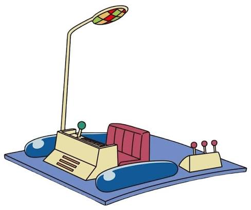

# Team Story Challenge

This is the starting draft of your team’s story.  
Your mission: **revise and improve it**, making it coherent, funny, and illustrated with the provided images.

---

## Our Wonderful Story

1. Once upon a time, there was a majestic **castle**, guarded by the realm's bravest (and most underpaid) **knight**.  
     
   

2. Then suddenly, a terrifying **dragon** appeared over the horizon… but wait, is that exhaust smoke? And why is it connecting to Wi-Fi? It was actually a giant **robot**!  
   

3. The **scientist** frantically shouted something critically important about disabling Bluetooth, but nobody wrote it down because everyone was busy recording a TikTok.  
   

4. A confused **wizard** attempted a reboot spell, but hit the wrong key combination. Reality glitched, teleporting everyone into the middle of nowhere right in front of a locked **treasure chest**…  
     
   

5. Someone picked up an ancient **map**, hoping for salvation—only to realize it had no compass rose, no legends, and was actually a grease-stained pizza receipt.  
   

6. “Arrr! When lost on land, take to the stars!” bellowed a confused **pirate** who had clearly wandered in from an entirely different genre.  
   

7. Everyone crammed into a makeshift **rocket** and blasted off, but halfway into orbit, the onboard **time machine** blew a fuse because someone plugged in an electric kettle.  
     
   

8. As alarms shrieked and gravity failed, the ship's **cat** calmly looked into the captain's eyes, cleared its throat, and purred:  
   > *“I love you... now feed me before we crash.”*  

   

9. Crash-landing straight into a dark forest, a world-class **detective** was already inspecting the crater with a magnifying glass, searching for clues.  
   

10. Suddenly, They found a scary ghost !

11. The ghost shouted, “Don’t be afraid! I’m the king of the castle, and someone stole my treasure!” The detective pointed at the treasure chest.

12. The pirate opened the treasure chest, hoping to find gold. Instead, he found a big red button with a sign that said, “DO NOT PRESS!”

13. The scientist shouted, “Don’t press that button!” But the pirate pressed it anyway. Suddenly, the time machine started working, and everyone was teleported to the moon!

14. Arriving on the moon, an **alien** and an **ogre** were already sitting on lawn chairs with popcorn, having watched the entire spectacle unfold.  
  

